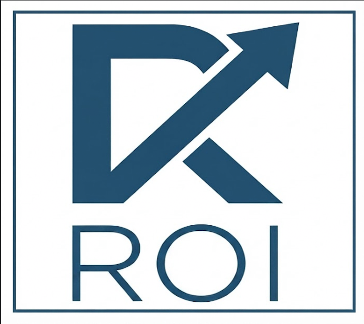

## **EDUCATION-CENTER** 

- One Customer (DBJ Method Adopter) has one EDUCATION-CENTER
  - The repository of artifacts, where factory workers train for DBJ CMM L3 (initial) , L4 and L5 (final) levels
 
**PIONEER** is the name for the imaginary customer

## **BPT-APP** is bpt instance repository generator

- One BPT instance is a production line for one product
- Product Factory has one or more production  lines
- BPT-APP , for a given customer and given product create the minimal repository based on the DBJ Method BPT concept.

---

Work is measured by what it returns. 

© Resilient ROI Ltd. | London, UK
